| LEMBAR KERJA PRAKTIKUM (LKP) — PERTEMUAN 5<br>Dokumentasi Implementasi Login Multi Role dan Management Pengguna<br>Mata Kuliah: Pemrograman Web Lanjut · Framework: Laravel · Database: MySQL / MariaDB |
| :---: |

**I. IDENTITAS PROYEK**

| Komponen | Isian |
| :---- | :---- |
| Nama Mahasiswa | Muhammad Lutfi Maulana |
| NIM | 2495114039 |
| Kelas / Semester | Teknik Informatika A / V (Lima) |
| Nama Kelompok | Kelompok 8 |
| Nama Projek | POS - Point Of Sale Kedai Kopi |
| Deskripsi Projek | Aplikasi kasir kedai kopi untuk mengelola menu, bahan baku, komposisi menu, transaksi penjualan, dan laporan penjualan bulanan. |
| Framework | Laravel 13 (PHP 8.4) |
| Database | MySQL / MariaDB |
| Repository Git | https://github.com/faisallzz/point-of-sale_kedai-kopi |
| Branch Pengerjaan | feature/lkp05-login-multirole |

---

**II. TUJUAN PRAKTIKUM**

Dokumentasi ini dibuat untuk mencatat implementasi fitur autentikasi dan pengelolaan pengguna pada projek kelompok.

**Tujuan:**

**1.** Mendokumentasikan proses login berdasarkan role pengguna (*Administrator, Kasir, Pemilik*).

**2.** Menjelaskan hak akses setiap role pada sistem melalui penegakan *middleware* dan perutean (*routing*).

**3.** Mendokumentasikan proses CRUD (*Create, Read, Update, Delete*) pengguna dengan proteksi integritas data transaksi.

**4.** Membuktikan hasil implementasi melalui pengujian sistem otomatis (*Feature Test*) dan pengujian antarmuka nyata.

---

**III. DESKRIPSI SISTEM LOGIN**

**3.1 Alur Login**

Pengguna melakukan login menggunakan nama pengguna (*username*) dan kata sandi (*password*) yang telah terdaftar pada sistem basis data kedai kopi. Sistem melakukan validasi kredensial, melakukan regenerasi sesi keamanan, kemudian mengarahkan pengguna secara otomatis ke halaman dasbor yang sesuai dengan perannya.

**Alur:**

**1.** Pengguna membuka halaman login pada URL `/login`.

**2.** Pengguna memasukkan nama pengguna (*nama_pengguna*) dan kata sandi (*password*).

**3.** Sistem melakukan autentikasi menggunakan `Auth::attempt()`.

**4.** Sistem membaca nilai kolom `peran` pada data pengguna yang berhasil login.

**5.** Sistem mengarahkan (*redirect*) pengguna sesuai hak aksesnya (`/admin/dashboard`, `/kasir/dashboard`, atau `/pemilik/dashboard`).

---

**IV. ROLE PENGGUNA SISTEM**

| No | Role | Deskripsi Hak Akses |
| :---: | :---- | :---- |
| 1 | Administrator (Role 1) | Memiliki hak akses penuh sistem: mengelola akun pengguna (CRUD), mengelola master menu dan stok bahan baku, serta memantau seluruh transaksi dan laporan kedai. |
| 2 | Kasir (Role 2) | Memiliki hak akses operasional kasir: melihat katalog menu, membuat dan mencatat transaksi pesanan penjualan baru, serta melihat riwayat transaksi kasir. Ditolak dari menu manajemen pengguna dan laporan keuangan. |
| 3 | Pemilik (Role 3) | Memiliki hak akses eksekutif/pengawasan: memantau omset dan rekapitulasi laporan penjualan bulanan, melihat daftar menu kedai. Ditolak dari penambahan/perubahan data master dan manajemen pengguna. |

---

**V. DOKUMENTASI LOGIN SETIAP ROLE**

**5.1 Login Role 1: Administrator**

| Komponen | Data |
| :---- | :---- |
| Nama Pengguna | admin_kopi |
| Password | admin123 |
| Role | admin |

**Hak akses:**

| Fitur | Akses |
| :---- | :---: |
| Dashboard | Ya |
| Melihat Data (Menu, Bahan Baku, Laporan) | Ya |
| Tambah Data | Ya |
| Edit Data | Ya |
| Hapus Data | Ya |
| Management User | Ya |

**Screenshot:**

| 📷 Bukti Tangkapan Layar: screenshots/login_role1.png |
| :---: |
| 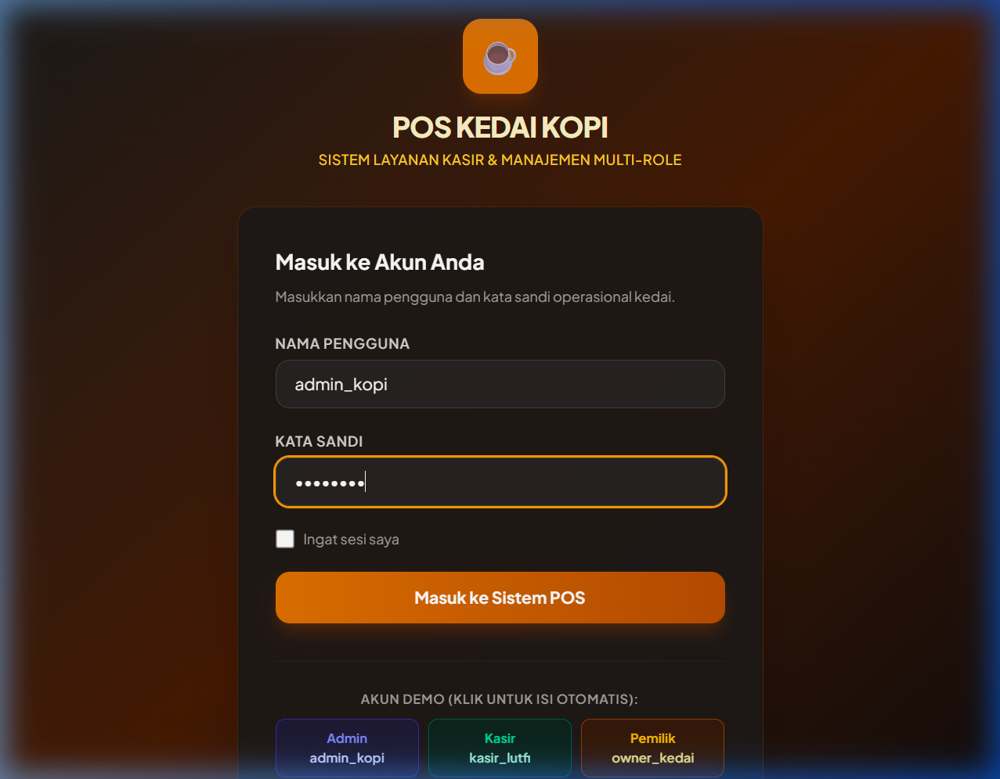<br>*Tampilan formulir login saat akun Administrator diisi.* |

| 📷 Bukti Tangkapan Layar: screenshots/dashboard_role1.png |
| :---: |
| 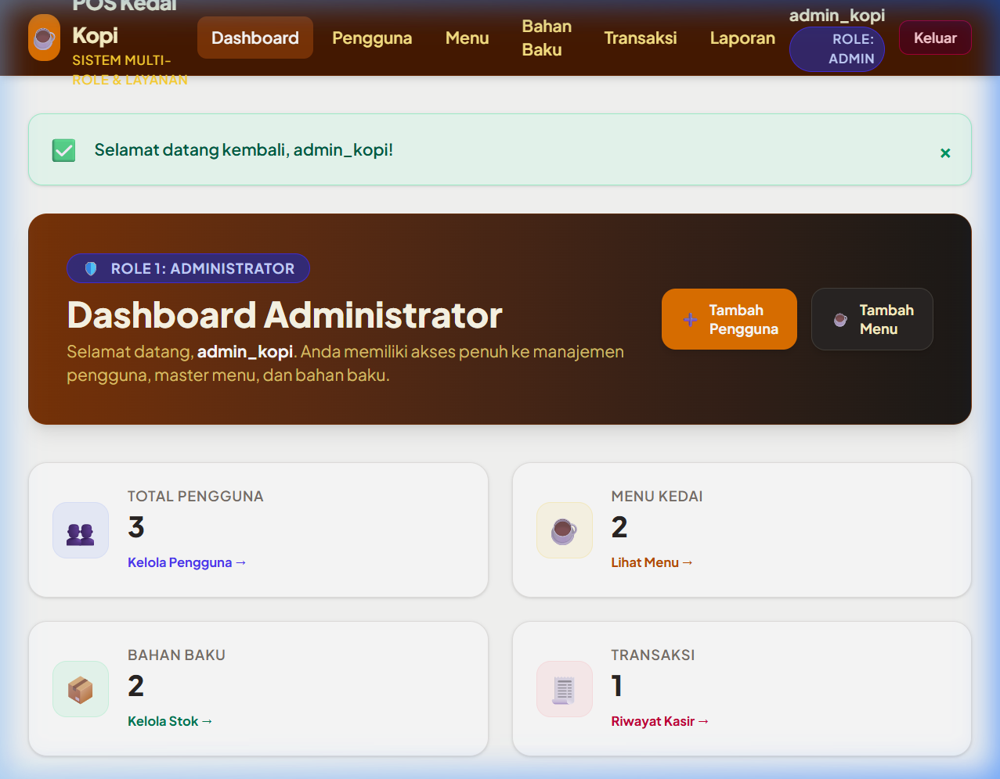<br>*Tampilan halaman Dashboard Administrator (/admin/dashboard) memperlihatkan kartu statistik dan otoritas Admin.* |

---

**5.2 Login Role 2: Kasir**

| Komponen | Data |
| :---- | :---- |
| Nama Pengguna | kasir_lutfi |
| Password | kasir123 |
| Role | kasir |

**Hak akses:**

| Fitur | Akses |
| :---- | :---: |
| Dashboard | Ya |
| Melihat Data (Menu & Transaksi) | Ya |
| Tambah Data (Transaksi) | Ya |
| Edit Data | Tidak |
| Hapus Data | Tidak |
| Management User | Tidak |

**Screenshot:**

| 📷 Bukti Tangkapan Layar: screenshots/login_role2.png |
| :---: |
| 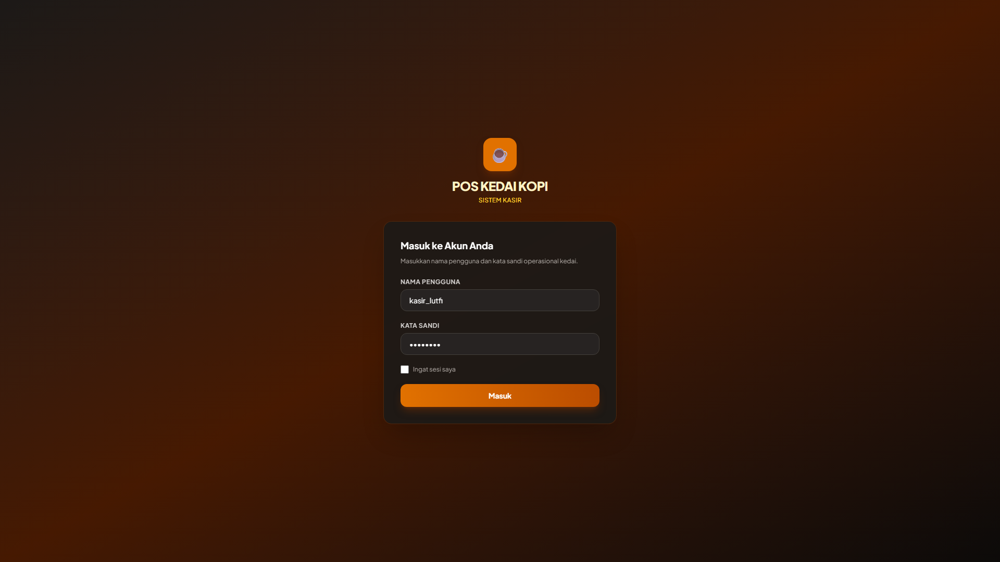<br>*Tampilan formulir login saat akun Kasir diisi.* |

| 📷 Bukti Tangkapan Layar: screenshots/dashboard_role2.png |
| :---: |
| 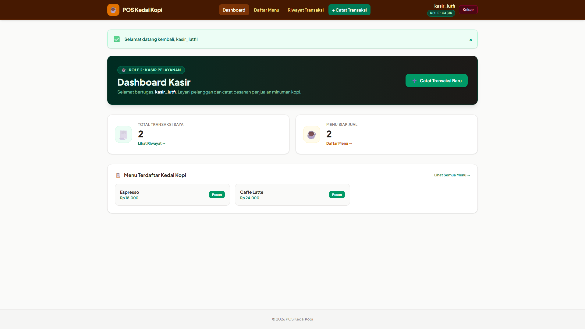<br>*Tampilan halaman Dashboard Kasir (/kasir/dashboard) dengan fitur cepat catat pesanan.* |

---

**5.3 Login Role 3: Pemilik**

| Komponen | Data |
| :---- | :---- |
| Nama Pengguna | owner_kedai |
| Password | owner123 |
| Role | pemilik |

**Hak akses:**

| Fitur | Akses |
| :---- | :---: |
| Dashboard | Ya |
| Melihat Data (Laporan & Menu) | Ya |
| Tambah Data | Tidak |
| Edit Data | Tidak |
| Hapus Data | Tidak |
| Management User | Tidak |

**Screenshot:**

| 📷 Bukti Tangkapan Layar: screenshots/login_role3.png |
| :---: |
| 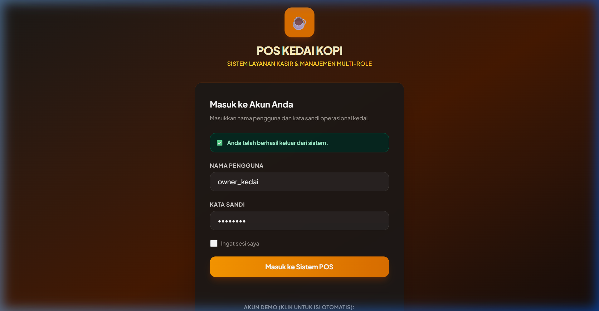<br>*Tampilan formulir login saat akun Pemilik (Owner) diisi.* |

| 📷 Bukti Tangkapan Layar: screenshots/dashboard_role3.png |
| :---: |
| 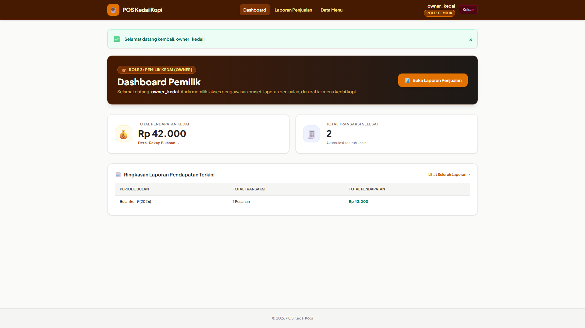<br>*Tampilan halaman Dashboard Pemilik (/pemilik/dashboard) memperlihatkan omset pendapatan dan ringkasan rekapitulasi.* |

---

**VI. MANAGEMENT PENGGUNA**

**6.1 Deskripsi**

Management pengguna merupakan fitur yang digunakan oleh Administrator sistem untuk mengelola akun pengguna sistem POS Kedai Kopi.

**Fitur meliputi:**

• Melihat daftar pengguna yang terdaftar beserta perannya.

• Menambahkan pengguna baru dengan validasi keunikan nama pengguna dan enkripsi kata sandi.

• Mengubah data nama pengguna, hak akses role, serta pembaruan kata sandi (opsional).

• Menghapus akun pengguna dengan proteksi keamanan (mencegah penghapusan akun diri sendiri yang sedang aktif dan mencegah penghapusan akun yang telah memiliki riwayat transaksi penjualan).

• Mengatur role pengguna (*admin*, *kasir*, *pemilik*).

---

**VII. STRUKTUR DATA PENGGUNA**

Struktur tabel `users` pada basis data projek:

| Field | Tipe Data | Keterangan |
| :---- | :---- | :---- |
| id | bigint unsigned | Primary Key (Auto Increment) |
| nama_pengguna | varchar(50) | Nama pengguna unik untuk kredensial login (Unique) |
| password | varchar(255) | Kata sandi terenkripsi (Bcrypt Hash) |
| peran | enum('admin','kasir','pemilik') | Hak akses/role pengguna kedai (default: kasir) |
| remember_token | varchar(100) | Token sesi autentikasi remember me (Nullable) |
| created_at | timestamp | Waktu pembuatan baris data (Nullable) |
| updated_at | timestamp | Waktu pembaruan baris data terakhir (Nullable) |

---

**VIII. CRUD MANAGEMENT PENGGUNA**

**8.1 Create User**

**Tujuan:**
Membuat akun pengguna baru untuk staf atau pengelola kedai kopi.

**Data input:**

| Field | Nilai |
| :---- | :---- |
| Nama Pengguna | kasir_baru |
| Password | password123 |
| Peran | kasir |

**Langkah:**
1. Login menggunakan akun Administrator (`admin_kopi`).
2. Membuka menu Pengguna (`/admin/users`).
3. Klik tombol "Tambah Pengguna Baru" (`/admin/users/create`).
4. Mengisi data Nama Pengguna, Kata Sandi, dan memilih Peran Kasir.
5. Klik tombol "Simpan Pengguna Baru".

**Screenshot:**

| 📷 Bukti Tangkapan Layar: screenshots/user_create.png |
| :---: |
| 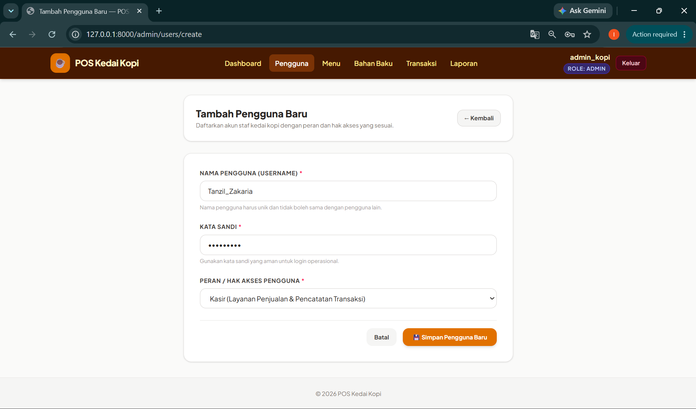<br>*Tampilan formulir penambahan akun pengguna baru di halaman /admin/users/create.* |

---

**8.2 Read User**

**Tujuan:**
Menampilkan seluruh daftar data pengguna yang tersimpan dalam sistem beserta perannya dan status riwayat transaksinya.

**Screenshot:**

| 📷 Bukti Tangkapan Layar: screenshots/user_list.png |
| :---: |
| 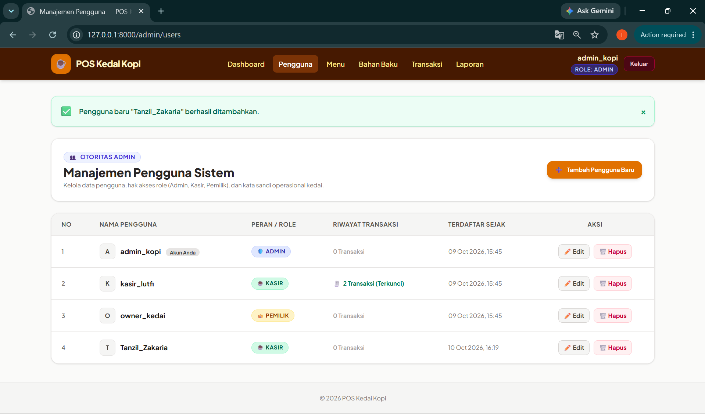<br>*Tampilan tabel daftar pengguna di halaman /admin/users menampilkan akun admin, kasir, dan pemilik.* |

---

**8.3 Update User**

**Tujuan:**
Mengubah informasi kredensial atau peran pengguna yang sudah terdaftar.

**Data yang dapat diubah:**

| Field | Status |
| :---- | :---: |
| Nama Pengguna | Bisa |
| Peran | Bisa |
| Kata Sandi (Opsional) | Bisa |

**Screenshot:**

| 📷 Bukti Tangkapan Layar: screenshots/user_edit.png |
| :---: |
| 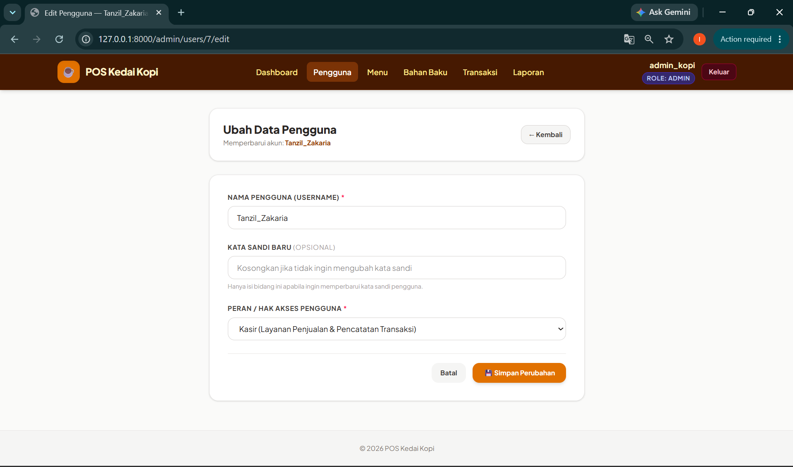<br>*Tampilan formulir pengubahan data pengguna pada halaman /admin/users/{id}/edit.* |

---

**8.4 Delete User**

**Tujuan:**
Menghapus akun pengguna dari sistem dengan aturan integritas data:
- Akun yang sedang login aktif tidak dapat menghapus dirinya sendiri.
- Akun pengguna yang sudah memiliki catatan riwayat transaksi penjualan dilindungi (*foreign key restrict*) dan ditolak dengan pesan yang ramah.

**Langkah:**
1. Membuka daftar pengguna pada menu Pengguna (`/admin/users`).
2. Memilih pengguna yang belum memiliki riwayat transaksi (misal: `kasir_baru`).
3. Klik tombol Hapus.
4. Sistem memproses penghapusan dan menampilkan notifikasi sukses.

**Screenshot:**

| 📷 Bukti Tangkapan Layar: screenshots/user_delete.png |
| :---: |
| 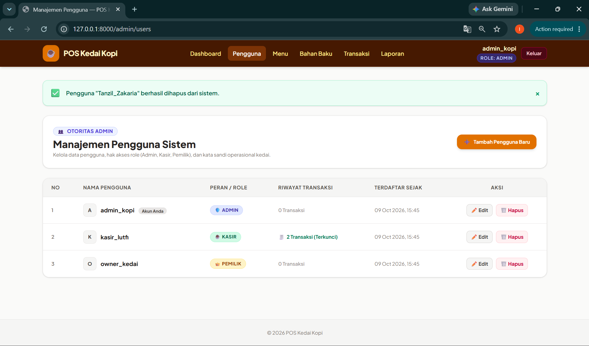<br>*Tampilan daftar pengguna setelah akun kasir_baru berhasil dihapus, menampilkan banner notifikasi sukses.* |

---

**IX. MATRIKS HAK AKSES ROLE**

| Fitur | Role 1 (Admin) | Role 2 (Kasir) | Role 3 (Pemilik) |
| :---- | :---: | :---: | :---: |
| Login | ✓ | ✓ | ✓ |
| Dashboard | ✓ | ✓ | ✓ |
| Melihat Data | ✓ *(Menu, Bahan Baku, Laporan)* | ✓ *(Menu & Transaksi)* | ✓ *(Laporan & Menu)* |
| Tambah Data | ✓ *(Menu, Bahan Baku)* | ✓ *(Transaksi)* | ✗ |
| Edit Data | ✓ *(User, Menu, Bahan)* | ✗ | ✗ |
| Hapus Data | ✓ *(User, Menu, Bahan)* | ✗ | ✗ |
| Management User | ✓ | ✗ | ✗ |

---

**X. HASIL PENGUJIAN**

| No | Pengujian | Skenario Uji | Hasil |
| :---: | :---- | :---- | :---: |
| 1 | Login setiap role berhasil | Login Admin (`admin_kopi`), Kasir (`kasir_lutfi`), dan Pemilik (`owner_kedai`) menggunakan kredensial valid | Berhasil |
| 2 | Redirect halaman sesuai role | Admin diarahkan ke `/admin/dashboard`, Kasir ke `/kasir/dashboard`, Pemilik ke `/pemilik/dashboard` | Berhasil |
| 3 | Pembatasan akses berjalan | Kasir dan Pemilik ditolak (Error 403 Forbidden) saat mencoba mengakses rute `/admin/users` atau fitur khusus Admin | Berhasil |
| 4 | Tambah pengguna berhasil | Admin menambahkan pengguna baru `kasir_baru` dengan password terenkripsi dan role tervalidasi | Berhasil |
| 5 | Edit pengguna berhasil | Admin mengubah nama pengguna dan peran akun pengguna tanpa harus merubah password jika dikosongkan | Berhasil |
| 6 | Hapus pengguna berhasil | Admin menghapus akun `kasir_baru`. Sistem menolak penghapusan akun aktif sendiri serta akun yang memiliki transaksi (`kasir_lutfi`) | Berhasil |

**Bukti Pengujian Pembatasan Akses (Error 403 Forbidden):**

| 📷 Bukti Tangkapan Layar: screenshots/akses_ditolak.png |
| :---: |
| 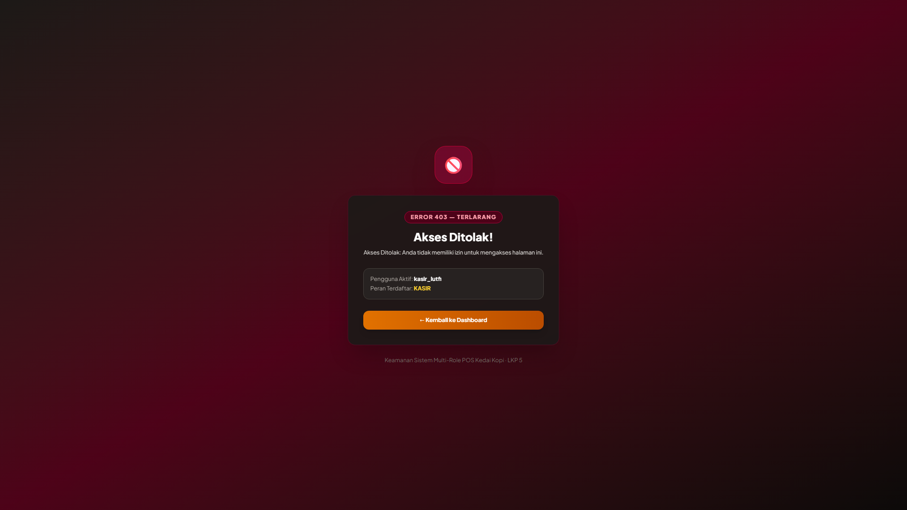<br>*Halaman respon 403 Forbidden yang ditampilkan sistem ketika role Kasir atau Pemilik mencoba membuka halaman manajemen pengguna.* |

*Hasil eksekusi Feature Test otomatis (`php artisan test`):*
```text
   PASS  Tests\Unit\ExampleTest
  ✓ that true is true

   PASS  Tests\Feature\ExampleTest
  ✓ the application returns a successful response

   PASS  Tests\Feature\AuthAndUserManagementTest
  ✓ login page can be rendered
  ✓ guest is redirected to login from protected pages
  ✓ login successful for admin and redirects to admin dashboard
  ✓ login successful for kasir and redirects to kasir dashboard
  ✓ login successful for pemilik and redirects to pemilik dashboard
  ✓ login fails with invalid password
  ✓ authenticated user can logout
  ✓ kasir is forbidden from admin user management
  ✓ pemilik is forbidden from admin user management
  ✓ admin can view user management page
  ✓ admin can create new user
  ✓ admin can update user
  ✓ admin can delete user without transactions
  ✓ admin cannot delete own account
  ✓ admin cannot delete user with existing transactions

  Tests:    17 passed (50 assertions)
  Duration: 4.25s
```

---

**XI. INFORMASI REPOSITORY**

| Komponen | Data |
| :---- | :---- |
| URL Repository | https://github.com/faisallzz/point-of-sale_kedai-kopi |
| Nama Repository | point-of-sale_kedai-kopi |
| Owner | faisallzz |
| Branch | feature/lkp05-login-multirole |

---

**XII. STRUKTUR FILE IMPLEMENTASI**

| File | Fungsi |
| :---- | :---- |
| `app/Models/User.php` | Model pengguna dengan penyesuaian atribut `fillable` (`nama_pengguna`, `password`, `peran`), enkripsi otomatis password, metode pembantu peran (`isAdmin`, `isKasir`, `isPemilik`), dan relasi `transaksiPenjualans`. |
| `app/Http/Controllers/AuthController.php` | Controller autentikasi untuk menampilkan form login, validasi nama pengguna dan kata sandi, regenerasi sesi, pengalihan dasbor spesifik per peran, serta proses logout aman. |
| `app/Http/Controllers/UserController.php` | Controller CRUD pengguna khusus Administrator dengan penegakan validasi unik, hashing password, dan proteksi integritas transaksi. |
| `app/Http/Controllers/DashboardController.php` | Controller penampil halaman dasbor terpisah untuk role Admin, Kasir, dan Pemilik beserta statistik relevan. |
| `app/Http/Controllers/MenuController.php` | Controller katalog menu kedai kopi yang dapat dilihat oleh seluruh peran dan dapat dikelola oleh Admin. |
| `app/Http/Controllers/BahanBakuController.php` | Controller pengelolaan data bahan baku mentah (biji kopi & susu) khusus Administrator. |
| `app/Http/Controllers/TransaksiController.php` | Controller pencatatan pesanan kasir dan riwayat transaksi kedai kopi. |
| `app/Http/Controllers/LaporanController.php` | Controller rekapitulasi laporan penjualan bulanan untuk Pemilik dan Administrator. |
| `app/Http/Middleware/CheckRole.php` | Middleware penjaga hak akses rute untuk memverifikasi peran pengguna dan menghasilkan respon 403 Forbidden jika otoritas tidak terpenuhi. |
| `bootstrap/app.php` | Pendaftaran alias middleware `role` ke kernel HTTP Laravel 13. |
| `routes/web.php` | Pendefinisian seluruh rute web yang dikelompokkan dengan middleware `auth` dan `role`. |
| `database/migrations/0001_01_01_000000_create_users_table.php` | Skema tabel `users` dengan kolom `nama_pengguna` dan enum `peran`. |
| `database/seeders/UserSeeder.php` | Data seeder untuk 3 akun pengguna utama (`admin_kopi`, `kasir_lutfi`, `owner_kedai`). |
| `resources/views/layouts/app.blade.php` | Master layout aplikasi dengan bilah navigasi dinamis berbasis role aktif dan penampil flash alert. |
| `resources/views/auth/login.blade.php` | Tampilan antarmuka formulir login responsif bertema POS kedai kopi. |
| `resources/views/dashboard/` | Tampilan dasbor spesifik: `admin.blade.php`, `kasir.blade.php`, dan `pemilik.blade.php`. |
| `resources/views/users/` | Tampilan antarmuka manajemen pengguna: `index.blade.php`, `create.blade.php`, dan `edit.blade.php`. |
| `resources/views/errors/403.blade.php` | Halaman tampilan kustom ketika hak akses pengguna ditolak (Error 403 Forbidden). |
| `tests/Feature/AuthAndUserManagementTest.php` | Pengujian fitur otomatis (*Feature Test*) mencakup seluruh skenario login, redirect, hak akses 403, dan CRUD pengguna. |

---

**XIII. CHECKLIST PENGUMPULAN**

| No | Komponen | Status |
| :---: | :---- | :---: |
| 1 | Source code sudah di repository | ☑ |
| 2 | Link repository tersedia | ☑ |
| 3 | Dokumentasi login selesai | ☑ |
| 4 | Dokumentasi role selesai | ☑ |
| 5 | Dokumentasi CRUD pengguna selesai | ☑ |
| 6 | Screenshot pengujian tersedia | ☑ |
